<!-- ═══════════════════════════  HERO  ═══════════════════════════ -->
<p align="center">
  
</p>

<p align="center">
  <a href="https://git.io/typing-svg"></a>
</p>

<p align="center">
  <a href="https://adilkhattak42201-del.github.io/portfolio/"></a>
  <a href="https://www.linkedin.com/in/muhammad-adil-744b2a35a/"></a>
  <a href="mailto:adilkhattak42201@gmail.com"></a>
  
</p>

<br/>

<!-- ═══════════════════════════  ABOUT  ═══════════════════════════ -->
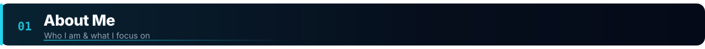

I'm **Muhammad Adil**, an AI & Data Science Engineering student from **Karachi, Pakistan**. I build **autonomous AI agents**, **n8n automation workflows** and **management software** that solve real problems for clinics, schools and businesses.

```yaml
currently_studying:  AI & Data Science Engineering @ SZABIST ZABTech · IT Training @ SMIT
currently_building:  Gmail Intelligence Agent (n8n + Gmail API) · Super AI Assistant
core_focus:          [Agentic AI, Voice AI, Machine Learning, NLP, Workflow Automation]
ask_me_about:        [n8n workflows, AI receptionists, Python, Pandas, Scikit-Learn]
open_to:             Internships · Collaborations · Freelance automation projects
```

<br/>

<!-- ═══════════════════════════  PROJECTS  ═══════════════════════════ -->
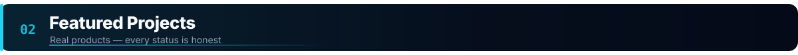

<table>
  <tr>
    <td width="50%"><a href="https://github.com/adilkhattak42201-del/ClassIQ-AI">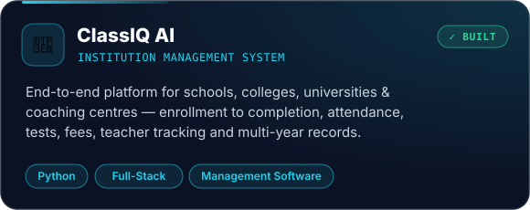</a></td>
    <td width="50%"><a href="https://github.com/adilkhattak42201-del/AI-Hospital-Receptionist">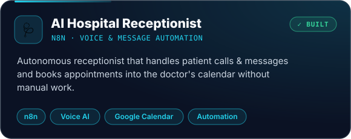</a></td>
  </tr>
  <tr>
    <td width="50%"><a href="https://github.com/adilkhattak42201-del/Gmail-Intelligence-Agent">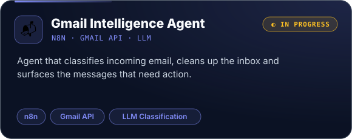</a></td>
    <td width="50%"><a href="https://github.com/adilkhattak42201-del/Super-AI-Assistant">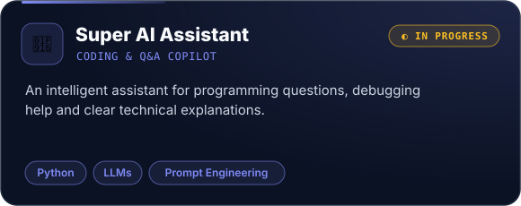</a></td>
  </tr>
</table>

<p align="center"><sub>🟢 Built &nbsp;·&nbsp; 🟡 In Progress &nbsp;·&nbsp; 🟣 Expanding — every status is the real, current state of the build.</sub></p>

<br/>

<!-- ═══════════════════════════  ASSIGNMENTS  ═══════════════════════════ -->
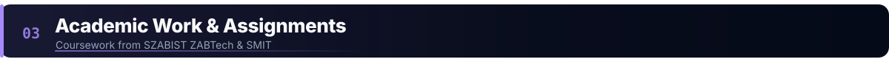

<table>
  <tr>
    <td width="50%"><a href="https://github.com/adilkhattak42201-del/SZABIST-Coursework">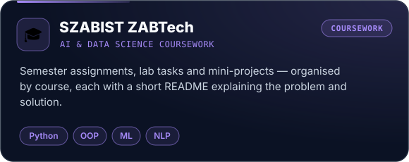</a></td>
    <td width="50%"><a href="https://github.com/adilkhattak42201-del/SMIT-Assignments">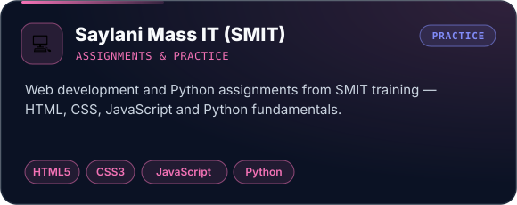</a></td>
  </tr>
</table>

<br/>

<!-- ═══════════════════════════  LEARNING  ═══════════════════════════ -->


<table>
  <tr>
    <td width="50%"><a href="https://github.com/adilkhattak42201-del/Data-Science-ML-Lab">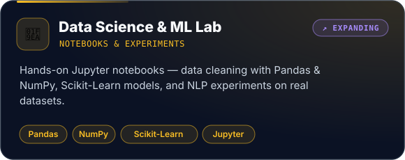</a></td>
    <td width="50%">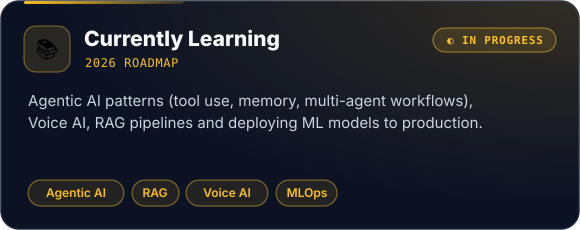</td>
  </tr>
</table>

| 🏅 Certification / Training | Institute | Focus |
|---|---|---|
| AI & Data Science Engineering | SZABIST ZABTech | Python · ML · NLP · Agentic AI |
| IT Training Program | Saylani Mass IT Training (SMIT) | Python · Web Development · AI Fundamentals |

<br/>

<!-- ═══════════════════════════  STACK  ═══════════════════════════ -->


<p align="center">
  
</p>

<p align="center">
  
  
  
  
  
  
  
  
  
</p>

<br/>

<!-- ═══════════════════════════  STATS  ═══════════════════════════ -->
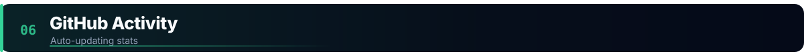

<p align="center">
  
  
</p>
<p align="center">
  
</p>
<p align="center">
  
</p>

<br/>

<!-- ═══════════════════════════  CONTACT  ═══════════════════════════ -->


<p align="center">
  <b>Need an AI receptionist, an n8n automation, or a management system?</b><br/>
  <sub>I reply to every message — usually within 24 hours.</sub>
</p>

<p align="center">
  <a href="mailto:adilkhattak42201@gmail.com"></a>
  <a href="https://www.linkedin.com/in/muhammad-adil-744b2a35a/"></a>
</p>


